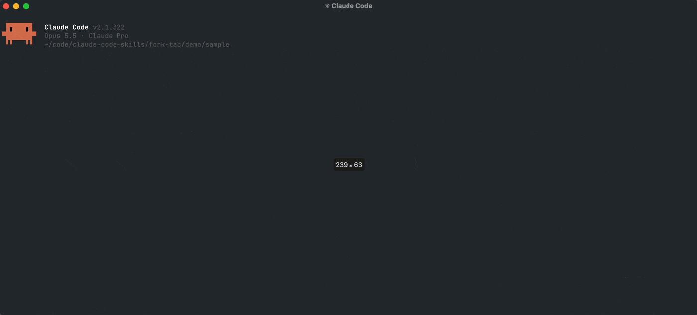

# /fork-tab

Fork the current Claude Code conversation into a new Ghostty **tab**, **split**, or **window**, with one slash command.



*The demo (played at 1.5× speed): I ask Claude what `rate_limiter.py` does, then run `/fork-tab`. In the new tab I go off on a tangent ("how would a token bucket compare?"). Back in the original tab, the tangent never happened, and the main thread carries on with a unit test. Recorded with [`demo/record-demo.sh`](demo/record-demo.sh).*

## Why I built this

Mid-way through a task I often want to chase a tangent: a side question, a "what if we did it the other way?", a quick experiment. Asking it in the main conversation pollutes the context. The tangent's back-and-forth stays in the session forever and nudges every later answer. Starting a fresh session throws away all the context that made the question worth asking.

Claude Code can already fork a session (`claude --resume <id> --fork-session`), but doing it by hand means opening a terminal, finding the session id, `cd`-ing to the right directory and typing the command. That's enough friction that I usually didn't bother.

`/fork-tab` makes the tangent free: type it, a new tab opens next to the current one with a full copy of the conversation, explore there, close it when done. The original session is never touched.

## Usage

```
/fork-tab      # new tab (default)
/fork-tab d    # split to the right
/fork-tab w    # new window
```

## How it works

- `SKILL.md` is a user-only slash command (`disable-model-invocation: true`). It runs `bin/fork-tab` with `${CLAUDE_SESSION_ID}` and `$PWD`, and it allowlists only that script.
- `bin/fork-tab` uses **Ghostty's own AppleScript dictionary** (Ghostty 1.3+) to open a surface that runs `claude --resume <id> --fork-session` in the same working directory. Nothing is typed into a focused window, so no Accessibility permission is needed.
- It walks up the process tree to find the **tty of the calling session**, then finds the Ghostty terminal with that tty. The new tab or split opens next to the session you forked from, even if another Ghostty window is in front.
- Paths and commands go to `osascript` through argv instead of being spliced into the script source, so spaces and quotes in paths can't break it. The caller's `PATH` is passed through, because Ghostty runs scripted commands with a bare system `PATH`.

## Requirements

- macOS, [Ghostty](https://ghostty.org) 1.3 or newer
- Claude Code (`claude` on `PATH`)

## Install

```sh
git clone https://github.com/vishalkotak/claude-code-skills
cd claude-code-skills && ./install.sh fork-tab
```

This copies `SKILL.md` to `~/.claude/skills/fork-tab/` and the script to `~/.claude/bin/fork-tab`. The first run asks macOS to let your terminal control Ghostty (Automation permission).
